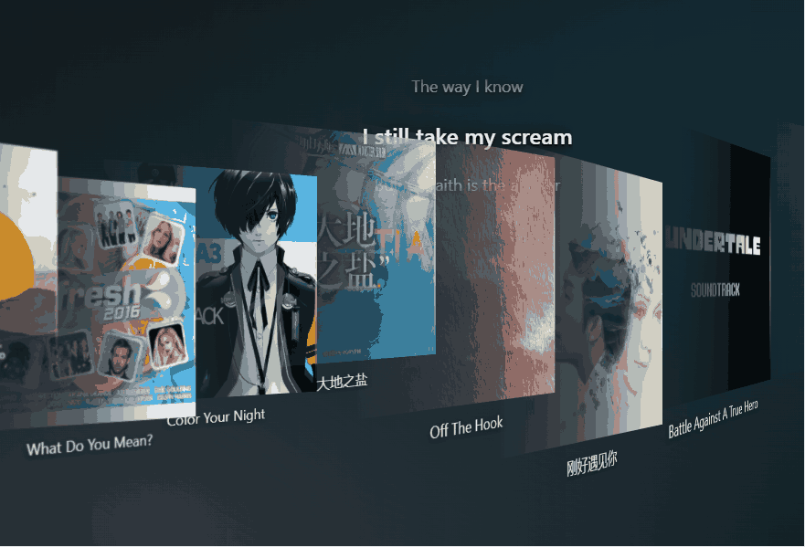
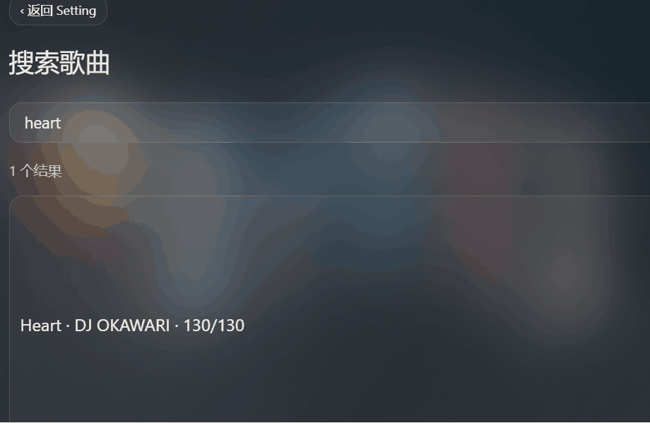

## Higher Music

**让歌单成为一座可以翻阅的档案馆。**

**Higher Music** 是一款面向 Windows 的音乐播放器。

围绕酷狗账号中的歌单展开：扫码连接、选择歌单，在竖直画廊、展墙与书脊之间切换，把查找音乐变成翻阅封套的过程。

> 本版专注账号歌单。没有全网搜索、本地音乐导入、歌单增删编辑、磁盘音乐缓存或自动登录功能。歌曲能否播放取决于平台返回、账号资格及音源可用性。

## 设计与交互

| 画廊 | 展示方式 | 浏览方式 |
| --- | --- | --- |
| 竖直 | 上下错落的专辑封面 | 纵向浏览 |
| 展墙 | 平面的封面组合 | 水平拖动、滚轮、方向键 |
| 书脊 | 3D 景深与鼠标视差、前后分层的封套、由透明端向清晰端过渡的渐变 | 水平拖动、滚轮、方向键 |

书脊中的封面及标题共享透视，悬停时封套轻轻上浮。点击书脊或展墙中的歌曲，会抽出封套并让两侧展开；核对信息后点击“播放这首”才提交播放。“放回”把封套送回原位置。
首尾使用带缓冲区的左右滑转场：书脊逐张叠牌，展墙平面接片。轻微反向操作不会立即触发回跳。它们并非始终首尾相连的环形画廊。
三个画廊的搜索共用“书脊寻址”动效。书脊与展墙定位后进入抽页预览；竖直画廊保留其原有定位并播放行为。减少动态效果或沉浸状态下使用轻量路径。

书脊画廊（鼠标跟随视差）：



书脊寻址：




书脊景深响应整个播放器内容窗口；设置面板打开时暂停响应。背景选项依次为 **自选、封面雾色、雅黑**。

## 下载与运行

在本仓库的 **Releases** 页面下载 `Higher Music-Windows-x64.zip`，完整解压，然后运行 `Higher Music.exe`。

- 面向 Windows x64；普通用户不需要另行安装 Node.js。
- 不要只复制 EXE，程序依赖同目录的 DLL、资源及 `resources/`。
- GitHub 自动生成的 Source code 压缩包不是可运行程序。
- 关闭旧版后再运行新目录中的程序。本包未提供代码签名或自动更新承诺。

## 第一次使用

1. 打开 Setting，扫码连接酷狗账号，在手机端确认。
2. 在曲库下拉框选择账号歌单。歌单列表只用于查看、筛选歌曲，不修改账号歌单。
3. 点击“进入画廊”，再选择要播放的歌曲。
4. 在 Setting 中切换竖直、展墙或书脊。
5. 按 `I` 或点击搜索按钮，输入歌名或歌手，在当前已进入画廊的歌单中定位。
6. 用底部播放、进度、音量、播放顺序及歌词偏移控件调整收听。

浏览书脊和展墙不会自动打断当前音乐。切换到另一份歌单并进入画廊会重建当前队列。

## 常用操作

| 操作 | 功能 |
| --- | --- |
| 空格 | 播放 / 暂停（输入框编辑时不抢占输入） |
| I | 当前歌单搜索 |
| F | 切换沉浸视图 |
| Esc | 关闭面板或退出当前视觉操作，取决于当前状态 |
| 鼠标拖动 / 滚轮 | 浏览画廊 |
| 画廊方向按钮 | 浏览相邻位置 |
| 放回 | 结束抽页预览 |

菜单中的系统全屏与应用内部沉浸视图是不同功能。以界面当前显示的快捷键和控件状态为准。

## 播放与平台连接

- 可浏览和选择的内容来自酷狗账号歌单，不提供独立歌曲添加入口。
- 内部仍保留同版本备用音源及歌词适配逻辑；“只播放账号歌单”指歌曲列表范围，并不表示所有实际音频必然来自同一个平台。
- 同名歌曲不等于同一录音版本。播放链路会检查版本、时长及相关标识，无法确认时可能拒绝播放。
- 歌词请求与音频请求分离。无歌词或纯音乐不会被视为整个播放器故障。
- 听歌历史同步可关闭。开启时，符合条件的真实播放超过 15 秒才尝试上报；暂停、缓冲和拖动等会影响本轮资格。备用源不会伪装为酷狗起播记录。
- 平台接口变更、地区限制、会员与购买状态、限流和网络错误都可能影响可用性。本项目不承诺所有歌曲均可播放。


## 从源码运行

建议使用 Windows x64、Node.js 22.13 或更高版本，以及 Git。Electron 开发依赖固定为 45.2.3。

```powershell
npm.cmd install
npm.cmd run setup:provider
npm.cmd start
```

连接组件安装脚本下载 `MakcRe/KuGouMusicApi` 的固定提交 `5d6c9f7b180279c9dd08bc6f7159de52a856d587`，安装到 `.runtime/source/KuGouMusicApi-main/`。此目录和 `node_modules/` 不提交 Git。

首次安装需要网络。若提示组件未安装，请检查上一条安装命令是否成功，不要跳过错误直接运行。设置脚本采用 `--ignore-scripts` 安装连接组件依赖。

目前没有提供从任意电脑一键生成安装器的构建链。源码启动不生成便携包；需要直接运行的用户请下载 Release 附件。

## 验证

```powershell
npm.cmd test
```

此命令运行本版账号歌单边界及播放会话、媒体引擎、歌词、历史计时和请求队列的选定回归检查。它使用模拟数据，不会验证你的真实购买权益或平台当下可用性。

`npm.cmd run test:legacy` 包含历史功能测试；其中本地库、全网搜索、自动登录等旧版预期可能与 n7.3.7 已移除功能冲突，不能把它视作本版全部应通过的验收集。

n7.3.7 已通过 47 项选定自动检查，以及三个画廊搜索、抽页、放回、首尾转场的浏览器检查。源码安装后的实际平台登录及播放仍需使用自己的账号验证。

## 项目结构

```text
electron/       桌面窗口、预加载桥、设置、系统控件
public/         界面、画廊动效、搜索与播放交互
lib/            平台适配、媒体代理、歌词、权限和调度
server.mjs      本机服务入口
scripts/        固定版本连接组件安装及模拟环境
test/           自动检查（含历史测试）
docs/images/    界面截图
```

部分历史模块仍保留在源码中，其产品入口已移除或被服务层关闭；本版可用功能以本文说明为准。

## 常见问题

**扫码后没有歌单？** 检查账号及酷狗标准版/概念版模式是否匹配，稍后重试。切换模式会重启并要求重新扫码。

**搜索不到歌曲？** 搜索只针对当前画廊歌单；请先进入目标歌单，不支持全网查找。

**封面加载慢或歌曲不能播放？** 封面和音频来自网络，预加载不能消除全部延迟。检查网络、账号资格与平台状态。

**源码 ZIP 为什么不能双击运行？** 它不包含 Electron 运行环境及安装后的依赖。普通用户应下载 Release 附件。


## 致谢与许可状态

感谢 Electron、Chromium、KuGouMusicApi 以及网易云接口组件等项目。此前设计参考与依赖说明见 [THIRD_PARTY_NOTICES.md](THIRD_PARTY_NOTICES.md)。本项目不是酷狗、网易云的官方客户端。

本项目目前未授予开源许可，`package.json` 标记为 `UNLICENSED`。公开源码不代表自动授予修改和再分发许可。第三方代码、运行时、专辑封面、歌词和音乐的权利归相应权利人，不因本仓库公开而改变。
